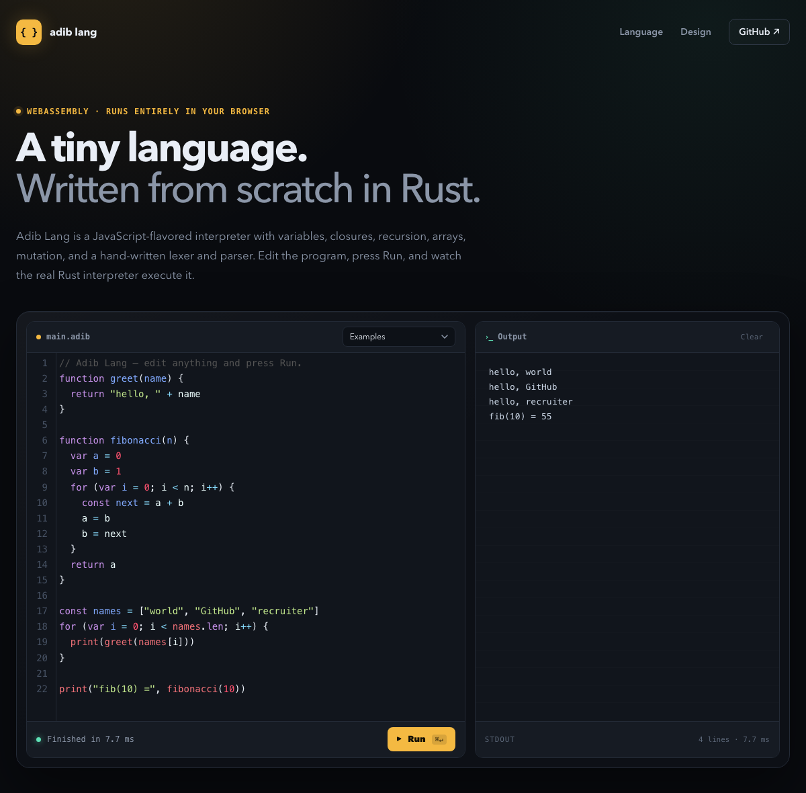

# Adib Lang

[](https://github.com/adibfahimi/adib-lang/actions/workflows/ci.yml)
[](https://adibfahimi.github.io/adib-lang/)
[](https://github.com/adibfahimi/adib-lang/releases)
[](LICENSE)

A small, tree-walking interpreter for a JavaScript-flavored language, written in Rust.

Adib Lang is a learning project that grew into a complete little language: lexer, parser, AST, and interpreter are all hand-written, with no parser generators or interpreter crates. It supports variables, control flow, first-class functions, closures, recursion, arrays, and a small standard library. The same Rust core compiles to WebAssembly and powers a live in-browser playground.

[](https://adibfahimi.github.io/adib-lang/)

**[Try the live playground →](https://adibfahimi.github.io/adib-lang/)** — edit a program, press Run, and the real interpreter executes in your browser. No install required.

```js
function twoSum(nums, target) {
  for (var i = 0; i < nums.len; i++) {
    for (var j = i + 1; j < nums.len; j++) {
      if (nums[i] + nums[j] == target) {
        return [i, j]
      }
    }
  }
  return null
}

const nums = [2, 7, 11, 15]
print(twoSum(nums, 9)) // [0, 1]
```

## Features

- **Hand-written lexer** with line/column tracking, `//` and `/* */` comments, string escapes, and multi-character operators.
- **Recursive-descent parser** with precedence climbing, so `1 + 2 * 3` is `7`, not `9`.
- **Lexical scoping and closures** backed by a chain of environments.
- **Recursion** — functions can call themselves.
- **Control flow** with `if`/`else`, `while`, and C-style `for` loops.
- **Arrays** with indexing, `.len`, and concatenation.
- **Runtime errors** with source positions instead of panics.
- **WebAssembly playground** with examples, keyboard shortcuts, and saved source.
- **No unsafe code** and a dependency list you can count on one hand.

## Install

```bash
cargo install --git https://github.com/adibfahimi/adib-lang.git
adib-lang examples/hello_world.adib
```

Or work from a clone:

```bash
git clone https://github.com/adibfahimi/adib-lang.git
cd adib-lang
cargo run -- examples/hello_world.adib
```

```
hello world!
```

Other examples:

```bash
cargo run -- examples/two_sum.adib
cargo run -- examples/fizzbuzz.adib
cargo run -- examples/fibonacci.adib
cargo run -- examples/closures.adib
cargo run -- examples/showcase.adib   # large end-to-end tour
```

Run the test suite:

```bash
cargo test
```

The suite covers the lexer, parser, interpreter, runtime errors, every example, and a golden output fixture for the large showcase program.

## Language tour

### Variables

`var` declares a mutable binding and `const` declares a constant. Both are block-scoped. A declaration without a value starts as `null`.

```js
var count = 0
const name = "Adib"
var pending

print(name)    // Adib
print(pending) // null
```

Assigning to an undeclared variable or to a `const` is a runtime error.

### Expressions

```js
print(1 + 2 * 3)       // 7
print((1 + 2) * 3)     // 9
print(10 % 3)          // 1
print(2 < 3 and 4 > 1) // true
print(!false)          // true
print(-5)              // -5
```

Precedence, from loosest to tightest: `or`, `and`, equality (`==`, `!=`), comparison (`<`, `<=`, `>`, `>=`), addition (`+`, `-`), multiplication (`*`, `/`, `%`), unary (`-`, `!`), and postfix access (`.`, `[]`, calls).

`and` and `or` short-circuit and require boolean operands.

### Control flow

```js
if (age >= 18) {
  print("You are eligible to vote.")
} else {
  print("You are not eligible to vote.")
}

var i = 0
while (i < 10) {
  print(i)
  i = i + 1
}

for (var i = 0; i < 10; i++) {
  print(i)
}
```

`if` and `while` conditions must be booleans. The `for` loop supports `i++`, `i--`, and `i = expression` in its update clause.

### Functions and closures

```js
function add(a, b) {
  return a + b
}

print(add(1, 2)) // 3
```

Functions are values. They capture the scope they were declared in, so closures and recursion work:

```js
function makeCounter() {
  var count = 0

  function increment() {
    count = count + 1
    return count
  }

  return increment
}

const counter = makeCounter()
print(counter()) // 1
print(counter()) // 2
print(counter()) // 3
```

A function with no `return` (or a bare `return`) evaluates to `null`.

### Arrays and strings

```js
const numbers = [1, 2, 3, 4, 5]
print(numbers.len)     // 5
print(numbers[0])      // 1
print(numbers[1] + 3)  // 5
print([1, 2] + [3, 4]) // [1, 2, 3, 4]

const word = "adib"
print(word.len)        // 4
print(word[1])         // d
```

`.len` counts Unicode characters for strings. Indexing is bounds-checked at runtime, and `.length` produces a helpful hint pointing at `.len`.

### Comments

```js
// This is a line comment.

/*
  This is a block comment.
*/
```

## Standard library

| Function | Description |
| --- | --- |
| `print(...values)` | Prints its arguments separated by spaces, followed by a newline. |

## Grammar

```ebnf
program      = { statement } ;
statement    = varDecl | functionDecl | ifStmt | whileStmt | forStmt
             | returnStmt | block | assignment | callStmt | ";" ;
varDecl      = ( "var" | "const" ) IDENT [ "=" expression ] ;
functionDecl = "function" IDENT "(" [ params ] ")" block ;
ifStmt       = "if" "(" expression ")" statement
             [ "else" statement ] ;
whileStmt    = "while" "(" expression ")" statement ;
forStmt      = "for" "(" [ statement ] ";" [ expression ] ";"
             [ update ] ")" statement ;
update       = IDENT ( "++" | "--" | "=" expression ) ;
returnStmt   = "return" [ expression ] ;
block        = "{" { statement } "}" ;
assignment   = IDENT "=" expression ;
callStmt     = IDENT "(" [ arguments ] ")" ;

expression   = orExpr ;
orExpr       = andExpr { "or" andExpr } ;
andExpr      = equality { "and" equality } ;
equality     = comparison { ( "==" | "!=" ) comparison } ;
comparison   = addition { ( "<" | "<=" | ">" | ">=" ) addition } ;
addition     = multiplication { ( "+" | "-" ) multiplication } ;
multiplication = unary { ( "*" | "/" | "%" ) unary } ;
unary        = ( "-" | "!" ) unary | postfix ;
postfix      = primary { "." IDENT | "[" expression "]" } ;
primary      = NUMBER | STRING | "true" | "false" | "null"
             | IDENT | "(" expression ")" | array | callExpr ;
array        = "[" [ arguments ] "]" ;
callExpr     = IDENT "(" [ arguments ] ")" ;
arguments    = expression { "," expression } [ "," ] ;
params       = IDENT { "," IDENT } [ "," ] ;
```

Semicolons are optional; they act as empty statements.

## How it works

For a deeper explanation of the lexer, parser, environment model, control flow, and trade-offs, see [`docs/DESIGN.md`](docs/DESIGN.md).

```
source text
    │
    ▼
┌─────────┐   tokens with line/column   ┌────────┐   AST   ┌─────────────┐
│  Lexer  │ ──────────────────────────▶ │ Parser │ ──────▶ │ Interpreter │
└─────────┘                             └────────┘         └─────────────┘
```

- `src/lexer.rs` converts source into tokens. Keywords live in a perfect-hash map (`phf`), and every token records its position for diagnostics.
- `src/parser.rs` builds an AST with a recursive-descent parser. Binary expressions use precedence climbing, and postfix access (`.len`, `[i]`, calls) is handled in one loop.
- `src/interpreter.rs` walks the tree. Environments form a parent chain of `Rc<RefCell<Environment>>`, which gives lexical scope and lets closures keep captured variables alive. `return` is modeled as an explicit control-flow value so it propagates correctly out of loops and nested blocks.
- `src/lib.rs` exposes `run_source`, and on `wasm32` exports a `run(source)` function for the browser.
- `web/` is the static playground: the editor, examples, output panel, and wasm loader.
- `tests/` contains end-to-end language tests that parse and execute real programs.

## WebAssembly playground

The crate is a `cdylib` with a `wasm32` export:

```rust
#[wasm_bindgen]
pub fn run(source: &str) -> String
```

It returns the program's output, or an error string prefixed with `error:`. The playground imports that function directly, so the browser runs the same interpreter as the CLI.

Build and serve it locally:

```bash
rustup target add wasm32-unknown-unknown
cargo install wasm-pack

wasm-pack build --target web --out-dir web/pkg --release
python3 -m http.server 4173 --directory web
```

Then open `http://localhost:4173`. The [`Deploy playground`](.github/workflows/pages.yml) workflow rebuilds and deploys it to GitHub Pages whenever the interpreter or web assets change.

## Roadmap

- [x] Live WebAssembly playground
- [x] Source-position diagnostics
- [ ] Objects and maps
- [ ] Index assignment (`arr[0] = 1`) and `+=`/`-=`
- [ ] `break` / `continue`
- [ ] String concatenation with non-strings
- [ ] `match` expressions (tokens are already reserved)
- [ ] A REPL
- [ ] Bytecode compiler and VM

## License

MIT © Adib Fahimi
